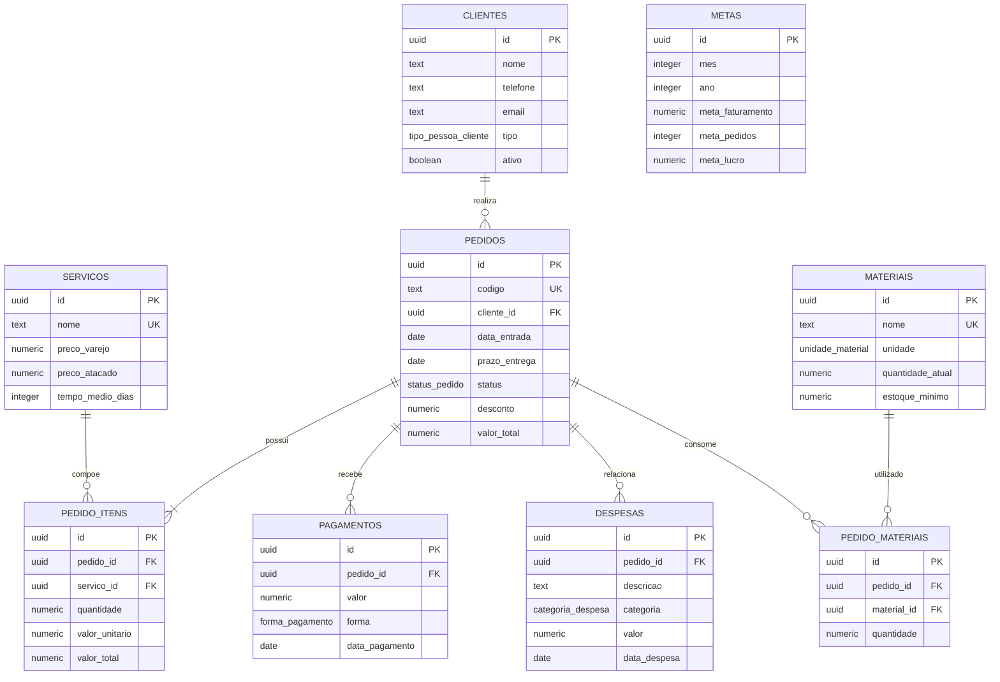

# Fase 1 — Modelo de dados da Mabie

## Plano da fase

1. Definir o monorepo `backend`, `frontend`, `database`, `postman` e `docs`.
2. Modelar o núcleo operacional em 3FN: clientes, serviços, pedidos, itens, pagamentos, despesas, materiais e metas.
3. Implementar integridade no PostgreSQL: enums, `CHECK`, chaves estrangeiras, índices, totais e estoque.
4. Criar views para os indicadores do dashboard e relatórios.
5. Habilitar RLS para usuários autenticados do Supabase e preparar dados fictícios.

## Decisões técnicas

- `uuid` identifica todas as entidades; `created_at` e `updated_at` padronizam auditoria.
- Valores financeiros usam `numeric(12,2)`, sem aritmética de ponto flutuante.
- Pedidos em orçamento não são duplicados: a aprovação altera o status do próprio pedido.
- Clientes não são excluídos pela API quando possuem pedidos; serão inativados com `ativo = false`.
- `pedido_materiais` registra o consumo e permite baixa/estorno transacional do estoque por trigger.
- O backend poderá consultar as views com a chave de servidor, mantendo o acesso direto ao banco fora do frontend.

## Diagrama ER

## Execução no Supabase

No SQL Editor, execute na ordem `schema.sql`, `views.sql`, `policies.sql` e `seed.sql`.
O seed é fictício e deve ser usado apenas em desenvolvimento/demonstração.
