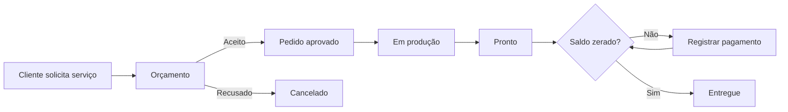
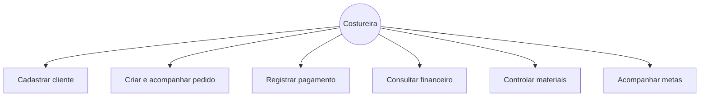

# Visão do produto Mabie e documentação acadêmica

## Contexto e stakeholders

| Stakeholder | Necessidade |
|---|---|
| Costureira (usuária única) | Registrar pedidos empresariais, controlar prazos, pagamentos, despesas e materiais sem depender de planilhas |
| Empresas e pessoas | Solicitar camisetas, moletons, jaquetas, calças e outras peças de vestuário com prazos e valores registrados |
| Faculdade | Avaliar a aplicação de modelagem de dados, API, interface e impacto extensionista |

O sistema é usado pela costureira no ateliê ou pelo celular. O principal limite operacional é a dependência de internet para acessar o Supabase; o sistema não mantém dados sensíveis no navegador além da sessão autenticada.

## Requisitos

### Funcionais

1. Autenticar a usuária por e-mail e senha.
2. Cadastrar e inativar clientes.
3. Cadastrar clientes como pessoa ou empresa.
4. Cadastrar serviços de vestuário com preços de varejo e atacado.
4. Criar pedido com itens, prazo e desconto.
5. Alterar status respeitando o fluxo do pedido.
6. Registrar pagamentos sem ultrapassar o total.
7. Registrar despesas e consultar lucro mensal.
8. Controlar materiais e alertar estoque abaixo do mínimo.
9. Definir metas mensais e acompanhar indicadores.
10. Consultar dashboard, prazos, atrasos e relatórios.

### Não funcionais

- TypeScript estrito e validação de entrada com Zod.
- RLS ativo no PostgreSQL e chave de servidor somente na API.
- Valores financeiros em `numeric(12,2)` e fuso do negócio em São Paulo.
- Interface responsiva em português do Brasil, com foco visível e estados de carregamento/erro/vazio.
- API versionada em `/api/v1` e erros no formato `{ error: { code, message } }`.

## Backlog priorizado

| Prioridade | Item | Critério de aceitação |
|---|---|---|
| P0 | Criar pedido | Usuária seleciona cliente/serviço, define prazo e visualiza o pedido na lista |
| P0 | Registrar pagamento | API rejeita valor maior que o saldo e mostra o saldo atualizado |
| P0 | Ver prazos | Dashboard lista atrasos e próximas entregas |
| P1 | Controle financeiro | Receitas, despesas e lucro mensal aparecem por período |
| P1 | Estoque | Material abaixo do mínimo gera alerta |
| P1 | Metas | Meta mensal é cadastrada e retornada no painel |
| P2 | Refinar relatórios | Views permitem comparativos e indicadores históricos |

## Fluxo principal

## Casos de uso

## Cronograma da proposta

| Etapa | Dias |
|---|---:|
| Levantamento | 5 |
| Definição da solução | 3 |
| Modelagem do banco | 8 |
| API | 12 |
| Painel web | 18 |
| Testes | 8 |
| Implantação | 5 |

## Riscos e qualidade

| Risco | Probabilidade | Impacto | Mitigação |
|---|---|---|---|
| Indisponibilidade de internet | Média | Alto | Mensagem de erro clara e reenvio da operação |
| Exposição de chave Supabase | Baixa | Crítico | `service_role` somente no `.env` do backend |
| Atraso não percebido | Média | Alto | View de atrasos, destaque de prazo e dashboard |
| Estoque divergente | Média | Médio | Trigger transacional de consumo e estorno |

Checklist: autenticação obrigatória, RLS, validação Zod, HTTPS no deploy, foco visível, contraste AA, textos em pt-BR, estados de carregamento/erro/vazio e confirmação para exclusões/inativações.
